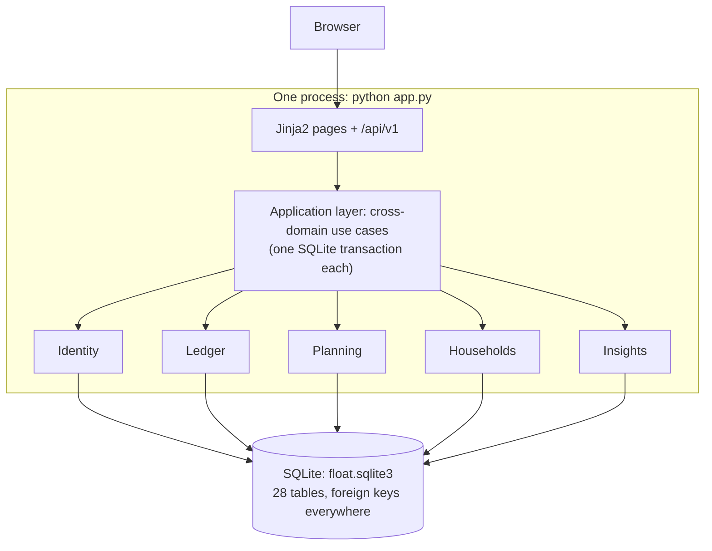
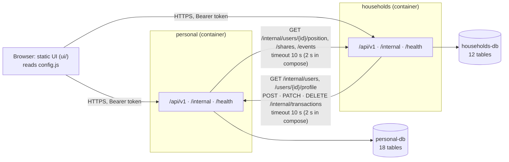
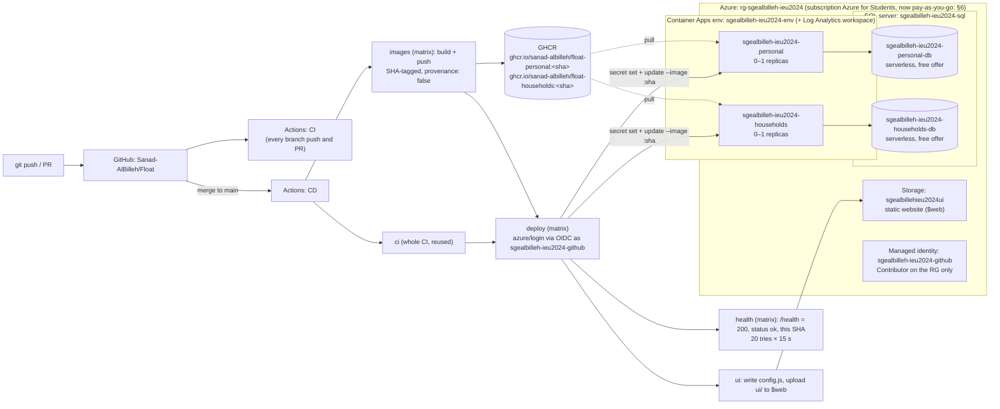
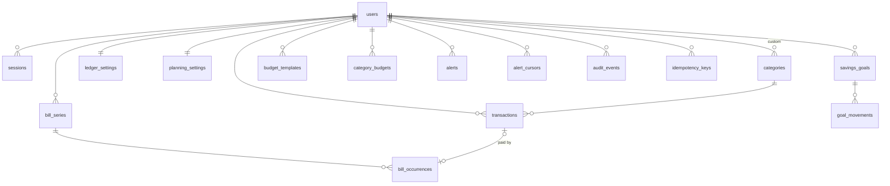
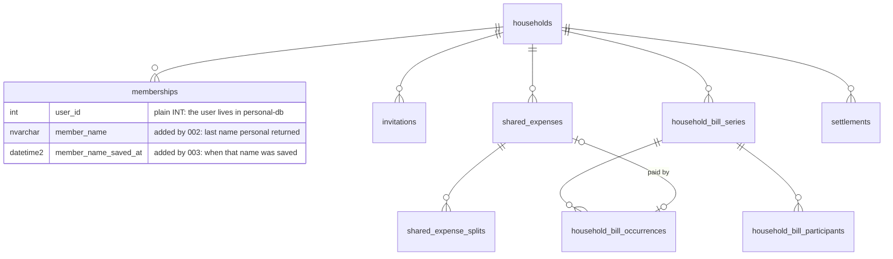

# Float, Assignment 2: from one process to two services on Azure

Sanad Albilleh (`sgealbilleh.ieu2024`) · Repository: https://github.com/Sanad-AlBilleh/Float · Graded commit: the one tagged `submission`

**Live URL:** https://sgealbillehieu2024ui.z1.web.core.windows.net (deployed 28 November 2026, region swedencentral)

## 1. What changed

In Assignment 1, Float was one Python process (FastAPI + Jinja2 pages + one SQLite file). ADR-2 named the seam where it would split: the application layer that coordinated **my personal money** (ledger, bills, goals, budgets) and **the shared flat** (households, shared expenses, settlements). Assignment 2 cuts exactly there (ADR-6):

- **personal** owns accounts and sign-in, the ledger, bills, goals, budgets, safe-to-spend, the forecast and alerts.
- **households** owns households, members, invitations, shared expenses and splits, balances, settlements and household bills.
- The **UI** is static HTML/CSS/JS in `ui/`, which calls both services from the browser. Their URLs come from `config.js`, which CD writes.

### Before: the Assignment 1 monolith

### After: two services, each with its own database

The **seam** is the set of `/internal` calls. Each one carries `X-Internal-Key` and is listed in `system.yaml` under `calls` with its timeout and what the user gets on failure. The calls exist in the other service's `openapi.json`, and `scripts/check_system.py` fails CI if they don't. Sign-in tokens are signed by personal with `TOKEN_SECRET` and checked locally by households, so households can still authenticate users while personal is down (ADR-6).

What used to be one SQLite transaction across two domains is now an HTTP call plus a compensating step. For example, recording a shared expense first asks personal for the payer's ledger row, then commits the expense. If personal fails, nothing is saved, and the user gets 503 *"Ledger unavailable"*. The A1 foreign keys from households into `users` and `transactions` became plain `INT` columns, checked in code at the seam (ADR-7).

## 2. Deployment

The resources are exactly the §7 allowance:
- 2 Container Apps in 1 environment
- 2 serverless databases on 1 server
- 1 storage account
- the managed identity
- the Log Analytics workspace that the environment creates

Everything is pay-per-use (ADR-8). No Azure password exists anywhere. The pipeline signs in through a federated credential that is trusted only for `refs/heads/main` of this repository. The database passwords and the shared secrets are GitHub secrets, which the pipeline hands to Container Apps as `secretref:` secrets. The one-time setup is in `infra/azure-setup.sh` and in the README.

## 3. Databases (one per service, matching the migrations)

Each service runs its own numbered migrations at startup (`services/<name>/migrations/*.sql`):
- Each file and its `schema_migrations` row are applied in one transaction.
- A file that has already been applied is skipped.
- With `max-replicas 1`, migrations never run twice at the same time.

**personal-db** (`001_init.sql`, 18 tables):

`login_attempts` and `health_probe` stand alone and are not shown.

**households-db** (`001_init.sql`, `002_member_name.sql`, `003_member_name_saved_at.sql`; 12 tables):

`audit_events`, `idempotency_keys` and `health_probe` are not shown. Columns that point at `users` or `transactions` (for example `memberships.user_id` and `shared_expenses.payer_transaction_id`) are plain `INT` columns with no foreign key, because those rows live in the other database.

## 4. Migration evidence

- **`002_member_name`** (on `main`, data-preserving): adds `memberships.member_name` as `NULL`, then fills every existing row with the name the pages already showed (`Member #<id>`). Nothing is dropped. The next successful read from personal replaces the fallback with the real name, so household pages keep real names while personal is down (§5, part 3 of the evidence).
- **`003_member_name_saved_at`** (PR #24) was held back on purpose. The first deploy applied `001` and `002` to empty databases, so it could not show a migration running on data. `003` changes a table that already holds data:
  - It adds `member_name_saved_at`.
  - It clears any stored `Member #<id>` fallbacks, which were never real names.
  - It stamps the real names with the time they were saved.
- **On Azure, 28 November** (full output in `docs/a2/evidence/migration-003-azure.md`):
  1. The first deploy ([run 46156463620](https://github.com/Sanad-AlBilleh/Float/actions/runs/46156463620)) applied `001` and `002`.
  2. In the live system, three users registered, two joined Ana's household, and three shared expenses were recorded.
  3. **Before:** `schema_migrations` holds `001_init` and `002_member_name`; 3 memberships (Ana, Ben, Carla); 3 shared expenses.
  4. I merged PR #24, and [CD run 46159868937](https://github.com/Sanad-AlBilleh/Float/actions/runs/46159868937) deployed it. The households container logged `migration applied: 003_member_name_saved_at.sql` at startup.
  5. **After:** `003_member_name_saved_at` is recorded; the same 3 memberships and 3 expenses are there; every real name has `member_name_saved_at` set. There were no fallbacks to clear on Azure, because every name had been read from personal.
- **Locally,** on a database holding 13 memberships, `003` kept all 13 rows, set the 7 fallbacks to `NULL` and stamped the 6 real names; a second boot applied nothing.

## 5. Partial-failure evidence

These are real responses from the compose stack, captured with `scripts/capture_partial_failure.sh` (full output in `docs/a2/evidence/partial-failure.md`). The same four cases are asserted by the cross-seam integration test `tests/integration/test_seam.py`, which is a CI gate.

| Situation | What the user gets |
|---|---|
| Both up | Ben's dashboard: `households_available: true`, owes €15.00 to the flat |
| **households stopped**, `GET /dashboard` | `200` in 0.02 s: `households_available: false`, household terms left out. The UI shows "Household balances are unavailable right now"; the rest of the dashboard works. |
| **personal stopped**, `GET /households/{id}` | `200`, members `["Ana", "Ben"]`: real names from migration 002, not `Member #id` |
| **personal stopped**, `POST /households/{id}/expenses` | `503` in 0.01 s: `{"title":"Ledger unavailable","detail":"Your ledger is unavailable right now, so nothing was saved. Try again in a minute."}` |
| Both back | The household's expenses are `[3000]`: the refused €5.00 expense was not half-saved |

A *slow* service (as opposed to a stopped one) is cut off by the timeout: 10 s by default, which is what Azure runs, because the other app may be starting from zero; 2 s in compose.

**Cold start** (§7.5). On Azure the first request after idle can get `503 "App port is not ready"` while the container starts and the database resumes. The UI (`ui/js/api.js`) handles it like this:
- Reads, logins and idempotent writes are retried with a "Float is starting up… Retrying" banner. After the last try, the banner offers a Retry button.
- A write that might already have run is not repeated. Instead the user gets "Not confirmed", with "Reload the page to check before trying again".
- When the page loads, the UI sends a `/health` call to both services, so they start waking up before the user acts.

## 6. Pipeline evidence

- **CI** runs on every branch push and pull request, and every job in it runs in parallel:
  - `system.yaml` checked against `system.schema.json` and against the code (`scripts/check_system.py`)
  - both OpenAPI documents validated
  - ruff
  - each service's tests with coverage ≥70%, against a SQL Server container
  - the cross-seam integration test on the compose stack
  - both image builds

  Measured coverage: personal 96%, households 91%.
- **CD** runs on every merge to `main`. `ci` and `images` run in parallel, then `deploy` (matrix), then `ui` and `health` in parallel (ADR-9).
- **Green CD runs on `main` that deployed to Azure:** https://github.com/Sanad-AlBilleh/Float/actions/runs/46156463620 (the first deploy) and https://github.com/Sanad-AlBilleh/Float/actions/runs/46159868937 (migration 003). Every job passed: CI, both image pushes, both deploys, the UI upload and both health checks, which require `200`, `"status":"ok"` and the commit's SHA.
- **Failed run that was fixed:** https://github.com/Sanad-AlBilleh/Float/actions/runs/44833781904, the CD run of the PR #20 merge.
  - *Cause:* the tests started checking every response against its OpenAPI schema with `jsonschema`, which was installed on my machine but missing from `requirements-dev.txt`. So on a clean runner, `conftest.py` failed with `ModuleNotFoundError: No module named 'jsonschema'`.
  - *Fix:* PR #21 added it to the test requirements, and the next run was green.
  - *Lesson:* CI is the clean machine I don't have locally.

### The subscription problem

My Azure for Students subscription (`805ac3d4-…`) was **Disabled** from 20 November to 28 November: "Your free credit has expired". "Reactivate" in the portal answered "Contact Azure Support". So that I could deploy before the deadline, on 28 November I upgraded the same subscription to pay-as-you-go. Nothing else changed: the same subscription, names, region policy and free allowances.
- Both databases are on the free offer with `AutoPause` when it runs out.
- The Container Apps scale to zero.

The expected cost is under €1 a month. Until then, everything that did not need Azure was built and tested in CI, so the whole Azure phase took about an hour:
1. `infra/azure-setup.sh`
2. the two contained SQL users
3. re-running CD

## 7. What I would do differently

- **Moving a transaction across a network call.** In A1, "record a shared expense and the payer's ledger row" was one SQLite transaction. Now it is a call followed by a commit. I chose "refuse with 503, nothing saved" over a queue, because it is simple to explain and to test. The cost is that recording money needs both services up.
- **Holding a migration back.** `003` exists only to be the on-data evidence. In a real system I would have run migrations on a staging copy of production data.
- **The subscription risk.** I would check the cloud account on day 1, not when the first deploy is due. Writing the deploy so it could be tested without the subscription is what kept the rest of the work moving, and it made the real deploy take an hour.

## 8. AI disclosure

I used Claude (Anthropic) as a coding and writing assistant throughout Assignment 2, as in Assignment 1. It drafted:
- code
- tests
- workflows
- the setup script
- parts of the README, the ADRs and this report

It also ran two independent code reviews per milestone. I decided the split, the data ownership, the failure behaviour and the hosting choices, and I reviewed, ran and corrected what it produced. Every prompt that shaped the system, what I kept and what I changed is logged in `AI_USAGE.md`.
